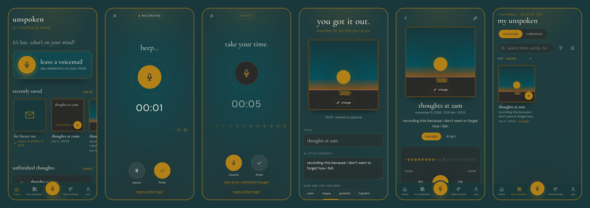

# unspoken

*for everything left unsaid.*



## About the Project

unspoken is a voice journal. Instead of writing entries, you record them like voicemails to yourself.

The idea came from how hard it can be to write down what you feel. Sometimes it's easier to just talk it out, like leaving a message for someone. With unspoken, you tap one button and speak, and your recording is kept in a private library on your device. No accounts, and nothing gets uploaded.

## Features

- **Record with one tap**, with no time limit. You can pause and resume anytime.
- **Live timer and waveform** while you record.
- **Optional prompts** like "how are you, really?" if you don't know what to say.
- **Personalize recordings** with a title, description, mood, tags, a cover photo, and extra photos. All of these are optional.
- **Library** with grid or list view, sorting, search, and filters.
- **Playback** with skip forward/back 10 seconds and speeds from 0.75x to 2x.
- **Drafts** so you can stop in the middle and continue later.
- **Collections** to group recordings together.
- **Little echoes**, which bring back an older recording each day.
- **Future me**, which locks a recording until a date you choose.
- **Passcode lock**, with face or fingerprint unlock on supported devices.
- **Backup and restore** using a single `.zip` file.
- **Works on any screen.** Phones get a bottom bar, and tablets and computers get a wider layout with a sidebar.

## Technologies Used

- **TypeScript** – main programming language
- **React** – building the screens
- **CSS** – styling
- **Vite** – running and building the app
- **IndexedDB (with Dexie)** – saving recordings and photos in the browser
- **MediaRecorder API** – recording from the microphone
- **Vitest and Puppeteer** – testing

## Getting Started

You need [Node.js](https://nodejs.org) 22.18 or newer and [Git](https://git-scm.com/downloads).

```bash
git clone https://github.com/rmarydessdapito/unspoken.git
cd unspoken
npm install
npm run dev
```

Then open [http://localhost:5173](http://localhost:5173) and allow microphone access when asked.

No database or extra setup is needed.

## How to Use

1. Go through the short intro, then tap **leave your first voicemail**.
2. Talk after the beep. Use **pause**, **resume**, and **finish**.
3. Add a title, photo, or mood if you want, then tap **keep it**.
4. Find your recordings in **my unspoken** and tap one to play it.
5. Use the **you** tab for settings, the passcode, and backups.

## Project Structure

```
unspoken/
├── src/
│   ├── screens/      the pages of the app
│   ├── components/   reusable parts like covers and the waveform
│   ├── lib/          recording, playback, search, backup and other logic
│   ├── db/           the database setup and saving/loading functions
│   └── styles/       the app's styling and colors
├── public/           app icons and hosting settings
├── tests/            unit tests
└── scripts/          the end-to-end browser test
```

## How It Works

- When you record, the app saves a small piece of audio **every 2 seconds** instead of waiting until you finish. If the app closes suddenly, the recording is kept as a draft.
- Pausing stops the recording without adding the paused time.
- Everything is saved in the browser's built-in database (IndexedDB), so it stays on your device.
- The waveform is drawn from how loud your voice was while recording.

## Concepts Applied

- React components and hooks
- TypeScript types and interfaces
- Async programming with `async`/`await`
- Storing data in the browser with IndexedDB
- Using browser features like the microphone and notifications
- Unit testing and end-to-end testing

## Future Improvements

- Transcribing recordings after they're saved
- Syncing recordings between devices
- Trimming the start or end of a recording
- More reliable reminders

## Author

**Made by** [@rmarydessdapito](https://github.com/rmarydessdapito)
